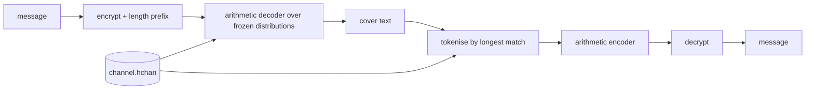
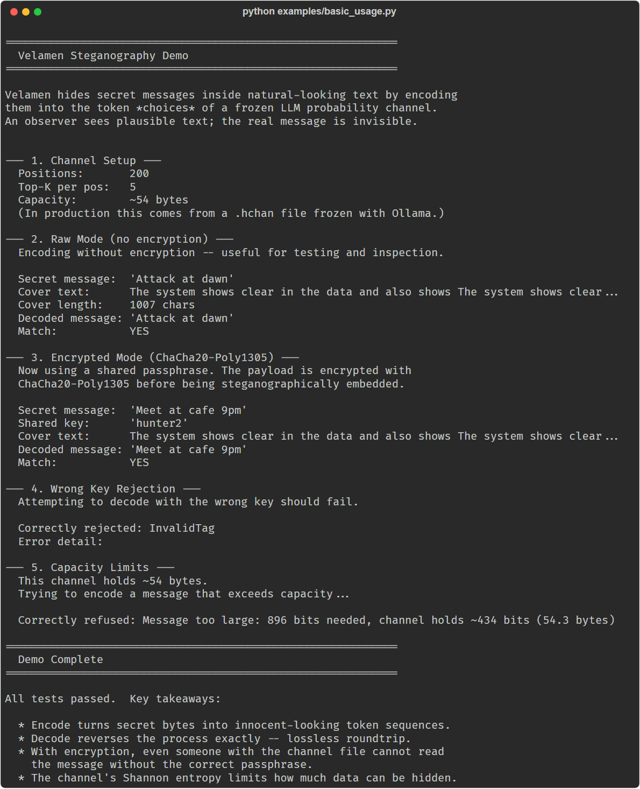

# Velamen

Steganographic communication over LLM token probability distributions: a Python library and CLI that hides a message in generated-looking text by arithmetic coding over a pre-frozen table of token probabilities.

Velamen encodes secret messages into LLM-style text using arithmetic coding over pre-frozen token probability distributions. Both sides hold the same frozen `.hchan` channel file, so no live model is needed at encode or decode time.

> **Correction, 2026-10-22.** This README said "The cover text is indistinguishable from normal model output." That is not established and does not hold by construction. Each position's distribution is frozen along the model's greedy path, but the encoder then picks tokens other than the greedy one, so later tokens are drawn from distributions conditioned on text that was never emitted. The table also keeps only the top 5 tokens per position, renormalised. No detectability evaluation exists in this repo. See also the second correction under [Quickstart](#quickstart).

## Status

Experimental (version 0.1.0). What works today, measured 2026-10-22 on `origin/main` at `213c107`:

- `encode` / `decode` round-trip, raw and encrypted, on a channel file: the 14 tests in `tests/` pass on Python 3.12, and `examples/basic_usage.py` round-trips on a synthetic channel.
- HCTP (`ContextChain`, `SyncPacket`, `AckPacket`) builds, serialises and verifies packets; the fixed SYNC overhead is 74 bytes, as documented.
- `velamen freeze` against a real Ollama model did not produce a usable channel in the one configuration tested (see the correction below). Treat channel freezing as not working until that is fixed.

## Install

Velamen is distributed as source from this GitHub repository only. It is not
published on PyPI; never install a package of this name from PyPI, it is not ours.
Install from git, pinned to a tag or commit you have reviewed (the commit below is
an example; replace it with the ref you want):

```bash
pip install "velamen @ git+https://github.com/saluca-labs/velamen@2d992c1a6157710227af792d43b89a034913491b"
# For encrypted channels (recommended):
pip install "velamen[crypto] @ git+https://github.com/saluca-labs/velamen@2d992c1a6157710227af792d43b89a034913491b"
```

Tested 2026-10-22 with Python 3.12.10 on Windows 11 (`cryptography` 50.0.2, `requests` 2.34.2). CI runs Python 3.10, 3.11 and 3.12. Requirements:

- Python 3.10+
- `cryptography` (optional, needed for encrypted mode)
- [Ollama](https://ollama.com), for `velamen freeze` only

For development, from a clone:

```bash
pip install -e ".[crypto,dev]"
python -m pytest tests/ -v
```

## Quickstart

The shortest run that produces a visible result needs no model. From a clone:

```bash
python examples/basic_usage.py
```

It builds a synthetic channel (hand-written distributions inside the script), then encodes and decodes in raw and encrypted mode. Excerpt of a real run, 2026-10-22:

```text
--- 2. Raw Mode (no encryption) ---
  Encoding without encryption -- useful for testing and inspection.

  Secret message:  'Attack at dawn'
  Cover text:      The system shows clear in the data and also shows The system shows clear...
  Cover length:    1007 chars
  Decoded message: 'Attack at dawn'
  Match:           YES
```

The full output is in [Screenshots](#screenshots).

> **Correction, 2026-10-22.** This README presented `velamen freeze` followed by `velamen encode --msg "attack at dawn"` as a working quick start. On 2026-10-22 it did not work in the configuration tested. With Ollama 0.34.4 and `gemma2:9b` (the README's `phi3:mini` was not available on the test machine and was not tested), a 200-position freeze produced a channel whose greedy text was the single token `Please` repeated, with a capacity of about 10 bytes, and `encode` refused the message:
>
> ```text
> $ velamen freeze --prompt "The quarterly earnings report indicated that" --model gemma2:9b --tokens 200 --out channel.hchan
> Freezing 200 positions for model 'gemma2:9b'...
> (progress line omitted)
> Done. 200 positions in 33.1s
> Channel saved: channel.hchan
> Fingerprint:  f5d335d16d377a7a6cba39617856093db659ac53a30eedf16d2527b061bc87bd
> Capacity:     ~2 bytes
> $ velamen encode --msg "attack at dawn" --channel channel.hchan --key "shared-secret"
> ValueError: Message too large: 400 bits needed, channel holds ~84 bits (10.5 bytes)
> ```
>
> The likely cause is in `velamen/channel.py`: `_query_top_k` calls Ollama's `/api/chat` with the growing text as a *user* message and `num_predict: 1`, so each position is the first token of a fresh assistant reply rather than the next token of a continuation. An encrypted message needs 36 bytes of overhead (4 length, 12 nonce, 16 tag, 4 guard) plus the message itself, so "attack at dawn" needs 50 bytes of capacity. Two freezes with identical arguments on the same machine also gave different channels (81 and 84 bits of capacity), so frozen channels are not reproducible from the prompt alone; exchange the `.hchan` file itself.

## Usage

### CLI

```bash
velamen freeze --prompt "<seed text>" --model <ollama model> --tokens 200 --out channel.hchan
velamen verify channel.hchan
velamen encode --msg "<message>" --channel channel.hchan --key "<shared passphrase>"
velamen decode --cover "<cover text>" --channel channel.hchan --key "<shared passphrase>"
```

`--raw` on `encode` / `decode` skips encryption; use it only for testing. `freeze` takes `--ollama <url>` (default `http://localhost:11434`). `verify` recomputes the SHA-256 fingerprint of the distributions and prints `Integrity: PASS` or `FAIL` (exit 1 on FAIL), as in the real run below on the channel frozen above:

```text
$ velamen verify channel.hchan
File:        channel.hchan
Fingerprint: f5d335d16d377a7a6cba39617856093db659ac53a30eedf16d2527b061bc87bd
Integrity:   PASS
Model:       gemma2:9b
Positions:   200
Capacity:    ~2 bytes
```

### Python API

```python
import json
from velamen import encode, decode

with open("channel.hchan") as f:
    channel = json.load(f)

cover = encode("secret message", channel, key="shared-key")
recovered = decode(cover, channel, key="shared-key")
assert recovered == "secret message"
```

`examples/encrypted_channel.py` shows an encrypted exchange between two parties and an eavesdropper with the wrong key, plus HCTP state sync, on a synthetic channel.

### HCTP: Hash-Chain Context Transfer Protocol

Velamen includes HCTP, a protocol for transferring conversational context as compact, tamper-evident, hash-chained payloads. Only deltas cross the wire; full history is a 32-byte root hash.

```python
from velamen import ContextChain

chain = ContextChain()
chain.add_turn("user", "What is the mission status?", "asked about mission status")
chain.add_turn("agent", "All systems nominal.", "confirmed systems nominal")

packet = chain.build_sync_packet()
wire_bytes = packet.serialize()  # 74 bytes + compressed delta
```

This example serialises to 281 bytes (74 fixed plus the compressed delta) in a 2026-10-22 run. See [docs/PROTOCOL.md](docs/PROTOCOL.md) for the full specification.

### Security

- **Encryption**: ChaCha20-Poly1305 AEAD (via the `cryptography` package)
- **Key derivation**: PBKDF2-HMAC-SHA256, 100,000 iterations, fixed salt `velamen-channel-v1`
- **Integrity**: HCTP hash chains provide tamper-evident session history
- **Channel security**: frozen distributions are a pre-shared secret; the `.hchan` file must be exchanged securely

## Architecture

1. **Freeze** (`velamen/channel.py`): query an Ollama model for the top-5 token log-probabilities at each position along a greedy path and save them, with a SHA-256 fingerprint and a capacity estimate, as a `.hchan` JSON file.
2. **Encode** (`velamen/stego.py`): prefix the message (or its ChaCha20-Poly1305 ciphertext) with a 4-byte length, treat the bits as an arithmetic-coded stream, and expand them into tokens chosen from the frozen distributions.
3. **Decode** (`velamen/stego.py`): split the cover text back into tokens by longest match against each position's distribution, re-compress to bits, read the length, and decrypt.



Key files: `velamen/cli.py` (CLI), `velamen/stego.py` (coding and crypto), `velamen/channel.py` (freeze and verify), `velamen/hctp.py` (HCTP), `docs/PROTOCOL.md` (HCTP specification; "Hermes" there names the stego transport that `velamen/stego.py` implements).

## Screenshots



Captured 2026-10-22 from a fresh clone at `213c107`; the command and rendering method are in [docs/img/basic-usage-demo-2026-10-22.txt](docs/img/basic-usage-demo-2026-10-22.txt).

## Citation

No archived record yet.

## License

Apache-2.0. See [LICENSE](LICENSE).

Copyright 2026 Saluca LLC.

## Links

- [docs/PROTOCOL.md](docs/PROTOCOL.md): HCTP specification
- [Ollama](https://ollama.com): the local model runtime `velamen freeze` calls

_Last updated: 2026-10-22_
